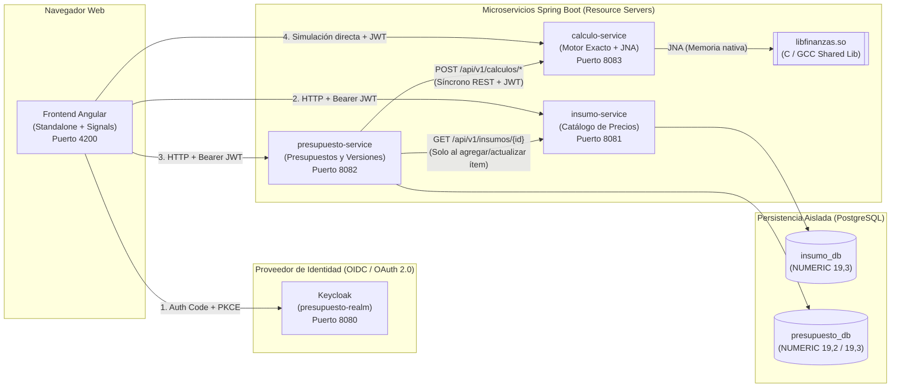

# 2. Descomposición en Microservicios e Interfaces (ADD Paso 3 y 4)

**Proyecto:** Presupuestador de Obra — UCEVA Devs  
**Cursos:** Programación en Ambiente Web 2 · Arquitectura de Computadores (Core Systems)  
**Referencia:** UC-72 / HU-39

---

## 1. Criterio de Descomposición ("Lo que cambia por razones distintas vive en servicios distintos")

La arquitectura divide el sistema en componentes según la frecuencia y la razón de cambio de sus reglas y datos:
- **El catálogo de insumos** cambia por condiciones del **mercado y proveedores** (inflación, listas de precios).
- **Los presupuestos y sus versiones** cambian por **negociación con el cliente y diseño de obra** (capítulos, cantidades, escenarios, aprobaciones).
- **Las fórmulas de cálculo y evaluación financiera** obedecen a **reglas matemáticas y financieras universales** que casi nunca cambian, pero requieren alta precisión y cómputo intensivo en código nativo (`libfinanzas.so`).

---

## 2. Diagrama de Topología y Flujo de Comunicación

---

## 3. Responsabilidades y Fronteras por Servicio

### 3.1. `insumo-service` (Puerto `8081`)
- **Responsabilidad única:** Administrar el catálogo maestro de insumos de construcción y su historial de precios.
- **Lo que guarda (`insumo_db`):**
  - `insumos`: `id` (UUID), `codigo` (único, ej. `CEM-001`), `descripcion`, `unidad_medida` (enum cerrado: `M`, `M2`, `M3`, `KG`, `BULTO`, `UNIDAD`, `DIA`), `precio_unitario` (`NUMERIC(19,3)`), `activo`, `updated_at`, `updated_by` (claim `sub` del JWT).
  - `historial_precios_insumo`: registro inmutable de cada cambio de precio con fecha y autor.
- **Lo que NO sabe:** No conoce qué es un presupuesto, un capítulo, una cantidad de obra ni el AIU. No lleva existencias de bodega ni movimientos de inventario.

### 3.2. `presupuesto-service` (Puerto `8082`)
- **Responsabilidad única:** Gestionar el ciclo de vida de los presupuestos, su estructura por capítulos e ítems, la inmutabilidad del precio cotizado, la comparación de escenarios, el versionado (snapshots enviados al cliente) y el estado de aprobación (`BORRADOR`, `APROBADO`).
- **Lo que guarda (`presupuesto_db`):**
  - `presupuestos`: `id`, `codigo`, `nombre`, `cliente`, `estado` (`BORRADOR` | `APROBADO`), `porcentaje_administracion` (`NUMERIC(7,4)`), `porcentaje_imprevistos` (`NUMERIC(7,4)`), `porcentaje_utilidad` (`NUMERIC(7,4)`), `costo_fijo` (`NUMERIC(19,2)`), `creado_por` (`sub`), `aprobado_por` (`sub`), `fecha_aprobacion`.
  - `capitulos`: `id`, `presupuesto_id`, `orden`, `codigo`, `nombre`.
  - `items_presupuesto`: `id`, `capitulo_id`, `orden`, `insumo_id`, `insumo_codigo`, `insumo_descripcion`, `unidad_medida`, `cantidad` (`NUMERIC(19,3)`), `precio_unitario_copia` (`NUMERIC(19,3)`).
  - `versiones_presupuesto`: snapshot JSON/relacional inmutable cuando el presupuesto se marca como enviado al cliente (RF-10).
- **Decisión clave de frontera (Copia vs. Referencia):** Al agregar un ítem al presupuesto, `presupuesto-service` consulta a `insumo-service` **una sola vez** y **copia** el `precio_unitario` vigente en `precio_unitario_copia`. Si el día de mañana sube el cemento en `insumo-service`, los presupuestos existentes conservan intacto su valor esperado. Solo una acción explícita del usuario (`POST /api/v1/presupuestos/{id}/sincronizar-precios`) actualiza los precios contra el catálogo vigente (permitido únicamente en estado `BORRADOR`).
- **Delegación de cálculos:** `presupuesto-service` no ejecuta fórmulas financieras ni redondeos por su cuenta; invoca a `calculo-service` enviando los ítems y parámetros para obtener los subtotales, AIU, márgenes, punto de equilibrio y evaluación financiera.

### 3.3. `calculo-service` (Puerto `8083`)
- **Responsabilidad única:** Motor determinista de cálculo presupuestal (en `BigDecimal` con `RoundingMode.HALF_UP`) y puente exclusivo hacia la biblioteca nativa `libfinanzas.so` mediante JNA (con respaldo configurable en Java puro).
- **Estado (Stateless):** **No tiene base de datos.** Recibe los datos de entrada en la petición, ejecuta el cálculo exacto o nativo y devuelve el resultado estructurado.
  - *Justificación contra RQ-02 y RQ-03:* Mantener `calculo-service` sin estado permite probar la totalidad de las reglas matemáticas y nativas en milisegundos sin levantar motores de base de datos, y permite escalar o reiniciar el contenedor nativo en segundos.
- **Encapsulamiento nativo:** Es el **único** componente del sistema que conoce `FinanzasLibrary` (JNA) y `libfinanzas.so`.

### 3.4. `frontend-angular` (Puerto `4200` / Nginx `80`)
- **Responsabilidad única:** Interfaz de usuario construida con componentes *standalone* y *signals* de Angular.
- **Restricción estricta:** No realiza sumas de capítulos, ni calcula AIU, ni márgenes en TypeScript. Toda modificación de cantidad o porcentaje dispara la petición al backend y renderiza la respuesta oficial.
- **Seguridad:** Cliente público OIDC (`Authorization Code + PKCE`) contra Keycloak y un `HttpInterceptorFn` funcional que adjunta `Authorization: Bearer <token>` a cada petición hacia los microservicios.

---

## 4. Decisiones de Comunicación e Infraestructura

1. **¿Hace falta un API Gateway con solo tres servicios?**
   - **Decisión:** **No se incluye un microservicio de API Gateway (Spring Cloud Gateway)** adicional. En producción/despliegue, el contenedor de Nginx que sirve el frontend Angular actúa como *reverse proxy* de borde (o Angular consume directamente las rutas con CORS restringido), y **cada uno de los 3 microservicios valida el JWT de forma autónoma** (RA-04).
   - **Justificación:** Un API Gateway Java adicional consumiría ~250 MB de RAM extra sin eximir a los microservicios de validar el token por su cuenta (requisito obligatorio RA-04).
2. **¿Comunicación síncrona o asíncrona?**
   - **Decisión:** **Comunicación 100% síncrona vía HTTP/REST (JSON).**
   - **Justificación:** Los casos de uso del presupuestador son interactivos de consulta-respuesta inmediata (cambiar un porcentaje de AIU y ver el nuevo precio de venta al instante, o calcular la TIR en menos de 1 segundo). Introducir colas de mensajería (RabbitMQ/Kafka) añadiría latencia, complejidad operativa y consistencia eventual innecesaria.
3. **Propagación del Token JWT entre servicios:**
   - Cuando `presupuesto-service` llama a `insumo-service` o a `calculo-service`, propaga la cabecera `Authorization: Bearer <token>` recibida del usuario para que el servicio destino valide criptográficamente tanto la identidad como el rol.

---

## 5. Matriz de Autorización por Endpoint (Contrato de Seguridad RA-05)

| Servicio | Operación / Endpoint | `presupuestador` | `revisor` | Sin Autenticar |
| :--- | :--- | :---: | :---: | :---: |
| `insumo-service` | `POST /api/v1/insumos` · `PUT /api/v1/insumos/{id}` (Crear/actualizar insumo y precio) | **200 / 201** | **403** | **401** |
| `insumo-service` | `GET /api/v1/insumos/**` (Consultar catálogo) | **200** | **200** | **401** |
| `presupuesto-service` | `POST /api/v1/presupuestos` · `PUT /api/v1/presupuestos/{id}/**` (Crear o editar presupuesto en `BORRADOR`) | **200 / 201** | **403** | **401** |
| `presupuesto-service` | `GET /api/v1/presupuestos/**` (Consultar presupuesto, versiones y su total) | **200** | **200** | **401** |
| `presupuesto-service` | `POST /api/v1/presupuestos/{id}/aprobar` (Aprobar un presupuesto) | **403** | **200** | **401** |
| `presupuesto-service` | `PUT /api/v1/presupuestos/{id}/**` cuando el estado ya es `APROBADO` | **403 / 409** | **403** | **401** |
| `calculo-service` | `POST /api/v1/calculos/**` (Ejecutar cálculos de presupuesto, sensibilidad, VPN, TIR y amortización) | **200** | **200** | **401** |
