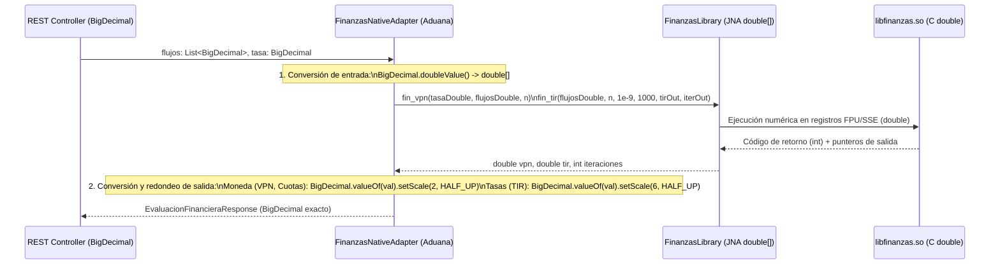

# 3. Representación del Dinero y Regla de Redondeo (Protocolo RQ-01)

**Proyecto:** Presupuestador de Obra — UCEVA Devs  
**Cursos:** Programación en Ambiente Web 2 · Arquitectura de Computadores (Core Systems)  
**Referencia:** UC-62 / HU-34 · RQ-01

---

## 1. La Decisión Arquitectónica

Toda cifra monetaria y cantidad de obra dentro del dominio transaccional y de cálculo presupuestal se representa mediante **`java.math.BigDecimal`** en Java, **`NUMERIC`** en PostgreSQL y **cadenas decimales exactas (o números decimales fijos serializados sin notación científica)** en JSON, prohibiendo el uso de `double` o `float` para almacenar o totalizar dinero.

> **Regla de Oro de Construcción en Java:**  
> Queda terminantemente prohibido instanciar `new BigDecimal(double)` (ej. `new BigDecimal(12.345)`), ya que hereda la imprecisión binaria IEEE 754 (`12.345000000000000639488...`). Toda instancia debe crearse desde `String` (`new BigDecimal("12.345")`) o `BigDecimal.valueOf(long, scale)`.

---

## 2. Escalas y Tipos por Capa del Sistema

| Concepto / Dato | Escala (Decimales) | Tipo en Java | Tipo en PostgreSQL | Ejemplo | Justificación |
| :--- | :---: | :--- | :--- | :--- | :--- |
| **Precio Unitario de Insumo** | **3** (`scale = 3`) | `BigDecimal` | `NUMERIC(19, 3)` | `12.345` | Exigido por el criterio de aceptación de **RF-01** y el estímulo de **RQ-01**. |
| **Cantidad de Ítem en Obra** | **3** (`scale = 3`) | `BigDecimal` | `NUMERIC(19, 3)` | `14.525` | Permite cantidades fraccionarias de obra ($m^2$, $m^3$, $kg$) sin truncamiento prematuro (**RQ-01**). |
| **Porcentajes de AIU ($A, I, U$)** | **4** (`scale = 4` como proporción o `2` como `%`) | `BigDecimal` | `NUMERIC(7, 4)` | `0.0800` (`8.00%`) | Evita errores de división por $100$ al aplicar porcentajes sobre el costo directo. |
| **Valor Parcial de Ítem** | **2** (`scale = 2`) | `BigDecimal` | Calculado / `NUMERIC(19, 2)` | `179.31` | Moneda legal (`COP` con centavos exactos para conciliación con hoja de control). |
| **Subtotal de Capítulo** | **2** (`scale = 2`) | `BigDecimal` | Calculado / `NUMERIC(19, 2)` | `15420310.45` | Suma exacta asociativa de los valores parciales ya redondeados del capítulo. |
| **Costo Directo, AIU ($A, I, U$) y Precio de Venta** | **2** (`scale = 2`) | `BigDecimal` | Calculado / `NUMERIC(19, 2)` | `98450120.00` | Garantiza que $\text{Precio Venta} = \text{Costo Directo} + A + I + U$ sin diferencia ni de un centavo ni de un peso. |

---

## 3. Protocolo Único de Redondeo y Orden de Suma (Conciliación con Hoja de Control)

Para que la suma por capítulos y la suma total coincidan al $100\%$ (`$0` de desviación) entre `calculo-service` y la hoja de cálculo de control (Excel / Google Sheets / CSV), se establece el siguiente protocolo matemático obligatorio:

### Regla de Redondeo Oficial
- **Modo de redondeo en Java:** `RoundingMode.HALF_UP` (redondeo aritmético comercial estándar: si la fracción siguiente es $\ge 0.5$, redondea hacia arriba en valor absoluto; equivalente a la función `REDONDEAR(valor; 2)` / `ROUND(value, 2)` de Excel).
- **Prohibición de redondeo en capa de vista:** Angular **no redondea para sumar**; recibe los valores ya redondeados en escala `2` desde el backend y únicamente los formatea visualmente.

### Los 5 Pasos Exactos del Cálculo Presupuestal (Punto Único de Redondeo por Nivel)

1. **Paso 1 — Valor Parcial del Ítem ($V_i$):**
   Para cada ítem $i$ con cantidad $Q_i$ (3 decimales) y precio unitario $P_i$ (3 decimales), el producto crudo tiene 6 decimales. Se redondea **en este punto exacto** a **2 decimales** con `HALF_UP`:
   $$V_i = \text{round}_{\text{HALF\_UP}}(Q_i \times P_i,\; 2)$$
   *En la hoja de control equivale a:* `=ROUND(Cantidad * PrecioUnitario, 2)`.  
   *Por qué es vital:* Si en la hoja de cálculo se sumaran los productos a 6 decimales ocultos y solo se formateara la celda a 2 decimales, alguien que sume la columna impresa con calculadora encontraría diferencias de varios pesos ("efecto centavo fantasma"). Al redondear explícitamente $V_i$ a 2 decimales, la suma es **estrictamente asociativa y conmutativa**.

2. **Paso 2 — Subtotal por Capítulo ($S_c$):**
   Es la suma exacta de los valores parciales $V_i$ (ya en escala 2) pertenecientes al capítulo $c$, respetando el orden de los ítems:
   $$S_c = \sum_{i \in c} V_i$$
   Como todos los $V_i$ tienen exactamente 2 decimales, esta suma **no requiere nuevo redondeo** y jamás pierde precisión.

3. **Paso 3 — Costo Directo Total ($CD$):**
   Es la suma exacta de los subtotales de todos los capítulos:
   $$CD = \sum_{c=1}^{K} S_c = \sum_{i=1}^{200} V_i$$
   Gracias al Paso 1, la suma de los subtotales de capítulo es **idéntica bit a bit** a la suma directa de los 200 ítems (**RF-03** y **RQ-01**).

4. **Paso 4 — Componentes del AIU Discriminados ($A, I, U$):**
   Cada componente se calcula sobre el Costo Directo ($CD$) y se redondea individualmente a **2 decimales** con `HALF_UP`:
   $$A = \text{round}_{\text{HALF\_UP}}(CD \times p_A,\; 2)$$
   $$I = \text{round}_{\text{HALF\_UP}}(CD \times p_I,\; 2)$$
   $$U = \text{round}_{\text{HALF\_UP}}(CD \times p_U,\; 2)$$

5. **Paso 5 — Precio de Venta Total ($PV$):**
   Para cumplir el criterio de aceptación de **RF-04** (*"aparecen los tres valores discriminados y el precio de venta es la suma verificable de los cuatro"*), el Precio de Venta se calcula como la **suma exacta de los cuatro valores visibles**:
   $$PV = CD + A + I + U$$
   *(No se calcula como $CD \times (1 + p_A + p_I + p_U)$ porque eso podría diferir en 1 centavo de la suma de los 4 renglones mostrados en pantalla).*

6. **Paso 6 — Los Dos Márgenes (RF-05) y Punto de Equilibrio (RF-06):**
   - **Margen sobre el costo ($\text{Markup}$):**
     $$\text{Margen}_{\text{costo}} = \text{round}_{\text{HALF\_UP}}\left(\frac{PV - CD}{CD} \times 100,\; 2\right)\%$$
   - **Margen sobre el precio de venta ($\text{Gross Margin}$):**
     $$\text{Margen}_{\text{venta}} = \text{round}_{\text{HALF\_UP}}\left(\frac{PV - CD}{PV} \times 100,\; 2\right)\%$$
   - **Punto de equilibrio ($PE$):** Dado el Costo Fijo ($CF$) y el Margen de Contribución Unitario ($MCU = PV_{\text{unit}} - CV_{\text{unit}}$):
     - Si $MCU \le 0$: devuelve estado de negocio `"CON ESTE PRECIO NO HAY PUNTO DE EQUILIBRIO"` (nunca excepción por división por cero ni `Infinity`).
     - Si $MCU > 0$: $PE = \text{round}_{\text{HALF\_UP}}(CF / MCU,\; 2)$.

---

## 4. Frontera entre el Dominio del Dinero Exacto (`BigDecimal`) y el Cálculo Aproximado en C (`double`)

En C no existe `BigDecimal` y métodos numéricos iterativos como la **TIR** requieren aritmética en punto flotante IEEE 754 de doble precisión (`double` de 64 bits) para converger. La arquitectura define una **única aduana de conversión** ubicada en la clase adaptadora `FinanzasNativeAdapter` dentro de `calculo-service`:

### Reglas de la Aduana JNA:
1. **Quién convierte:** Exclusivamente `calculo-service` en el adaptador que envuelve a JNA. Ningún otro servicio ni el frontend maneja `double`.
2. **Al entrar a C (`BigDecimal` $\to$ `double`):**
   - Los flujos de caja (`List<BigDecimal>`) y el capital se convierten a `double[]` mediante `.doubleValue()` únicamente en el instante previo a invocar `FinanzasLibrary.INSTANCE`.
3. **Al salir de C (`double` $\to$ `BigDecimal`):**
   - Si la función en C devuelve un código de error (`< 0`, por ejemplo no convergencia en `fin_tir`), **no se convierte ningún número** y se traduce inmediatamente al estado semántico `"NO_CONVERGIO"` junto con el número de iteraciones alcanzado (`iter_out`).
   - Para resultados monetarios (**VPN** y cada celda de la **tabla de amortización**: cuota, interés, abono, saldo): se convierte mediante `BigDecimal.valueOf(resultadoDouble).setScale(2, RoundingMode.HALF_UP)`.
   - Para tasas financieras (**TIR**): se convierte mediante `BigDecimal.valueOf(tirDouble).setScale(6, RoundingMode.HALF_UP)` (representando porcentaje con 4 decimales, ej. `0.045678` = `4.5678%`, cumpliendo el criterio de **RF-08** de coincidir en al menos cuatro decimales).
